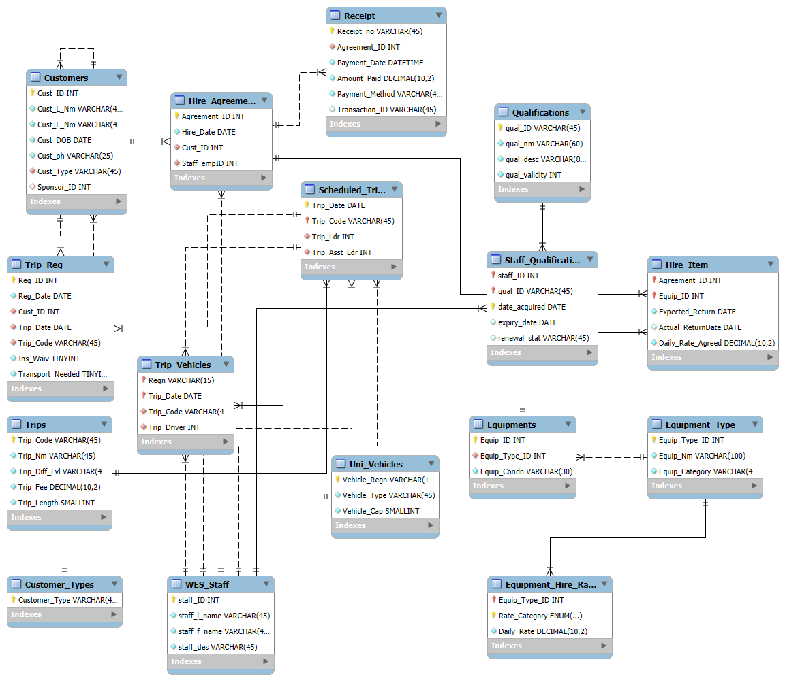

# Wilderness Exploration Society database

A MySQL database design for equipment hire and outdoor trip registrations at the fictional Aotearoa University. Originally developed by Team Powerhouse for MBIS623 (2025), with a revised schema prepared in 2026.

The database covers customers and guest sponsorship, scheduled trips and registrations, equipment inventory and hire agreements, vehicle assignments, and staff qualifications. Equipment hire and trip participation are independent activities.

## Schema diagram

Updated schema diagram exported from MySQL Workbench.

[Open the full-size diagram](docs/images/schema-diagram.png).

## Repository contents

| Path | Purpose |
| --- | --- |
| `sql/01_schema.sql` | Current revised schema: 16 tables and 19 foreign keys |
| `sql/02_example_queries.sql` | Example operational queries |
| `docs/images/schema-diagram.png` | Updated schema diagram displayed above |
| `docs/design.md` | Design changes, assumptions, and remaining limitations |
| `archive/original-schema.sql` | Original Workbench SQL export |
| `archive/ProjFile_Powerhouse.mwb` | Original Workbench model |
| `archive/SchemaDiag_Powerhouse.pdf` | Original diagram; does not reflect the revised SQL |
| `local-only/` | Original report and course brief, excluded from Git |

## Create the database

Use MySQL 8.0.16 or later. Open `sql/01_schema.sql` in MySQL Workbench and execute it against a local MySQL server. It creates `wes_corrected` and four customer-category rows. Run it once against an empty schema; it is not an upgrade script for an existing database.

No operational sample data is included yet. Run `sql/02_example_queries.sql` after adding data; queries return no rows on an empty database.

## Recreate and edit the diagram

1. In MySQL Workbench, choose **File > New Model**.
2. Choose **File > Import > Reverse Engineer MySQL Create Script**.
3. Select `sql/01_schema.sql` and enable **Place imported objects on a diagram**.
4. Execute the import, arrange the tables, and save the revised model separately from the archived original.

SQL can also be imported into drawDB for browser editing. Review exported SQL for constraints that a diagram tool may omit. Table positions are stored in a diagram/model file, not in SQL.

## Status

The schema has been reviewed structurally but has not been executed on a MySQL server. Some business rules require additional application logic or triggers; see `docs/design.md`. No application interface or deployment is included.

## Attribution

Original academic project: **Team Powerhouse**, MBIS623, October 2025. This repository preserves the original design separately from subsequent revisions. No license has been assigned; agree on licensing with the contributors before distributing their work under an open-source license.
